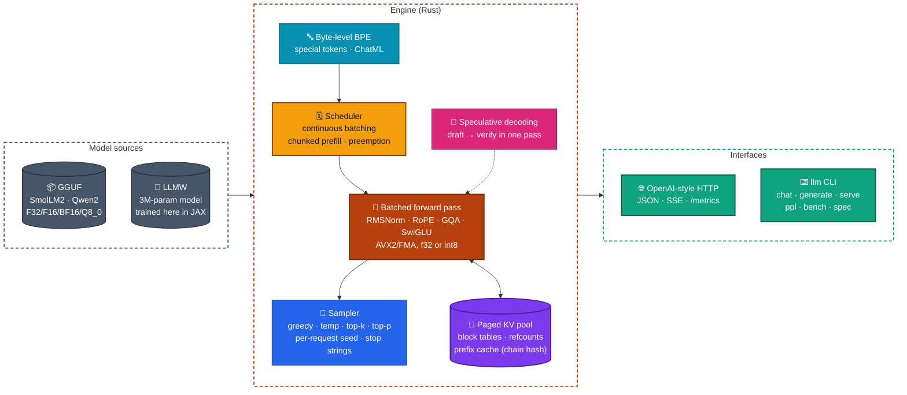
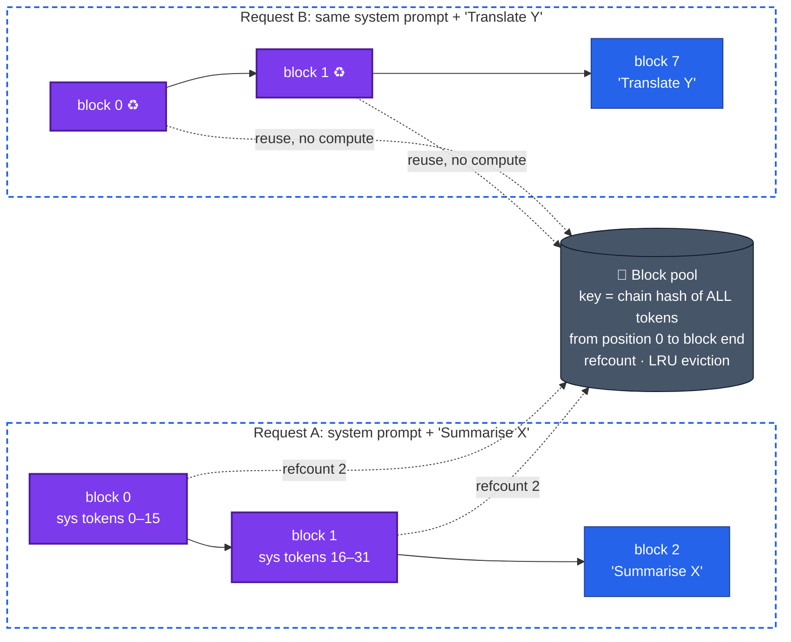
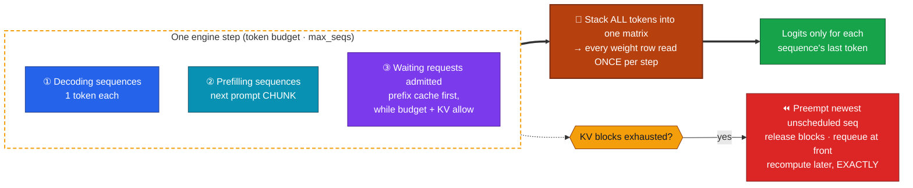
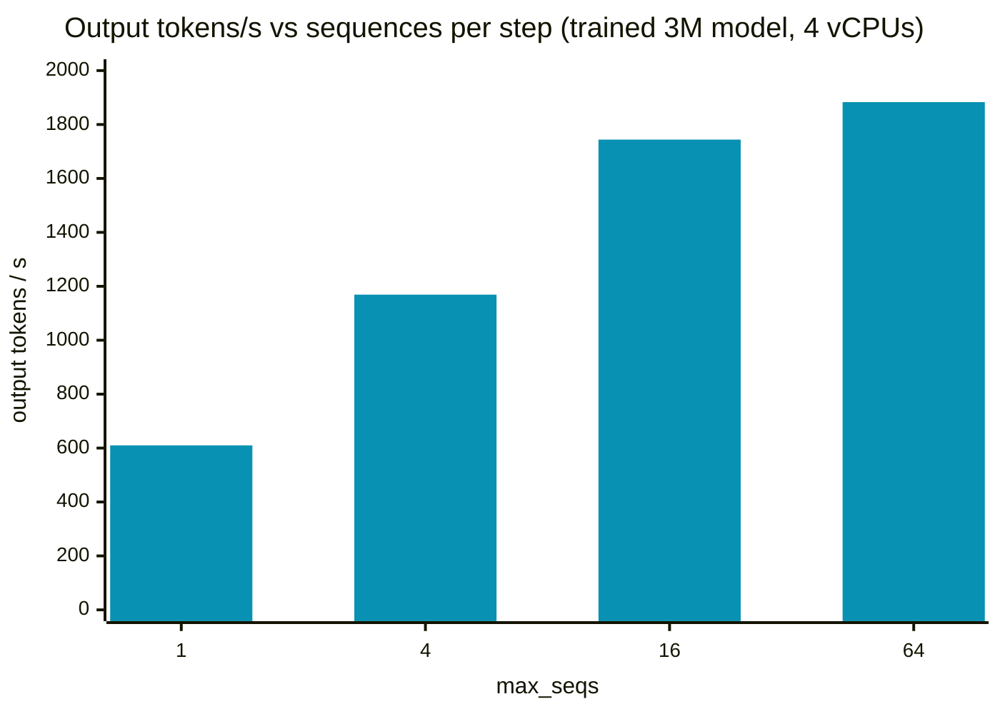
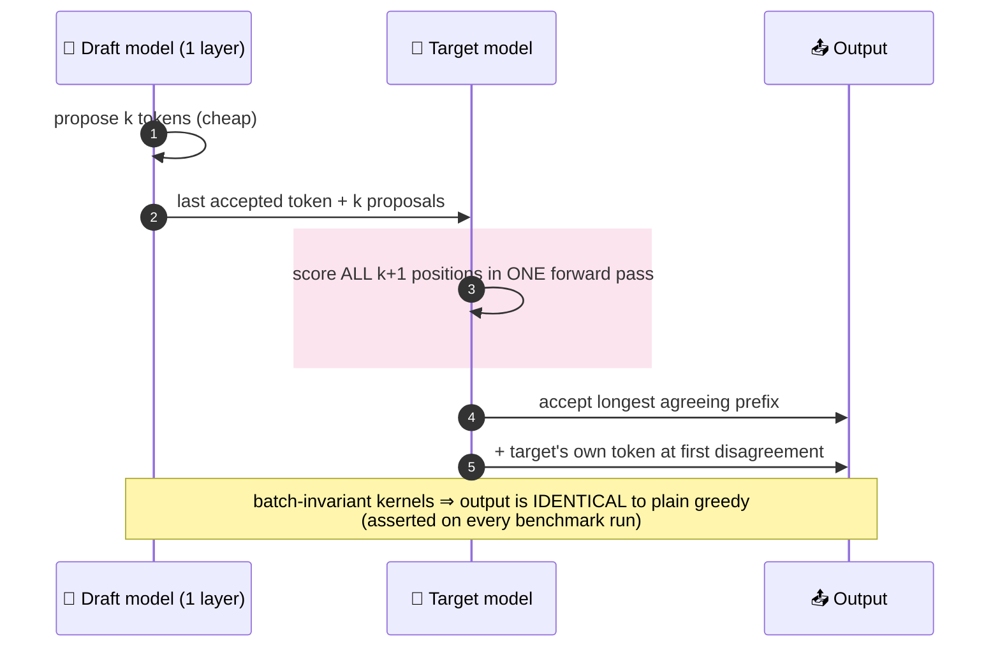
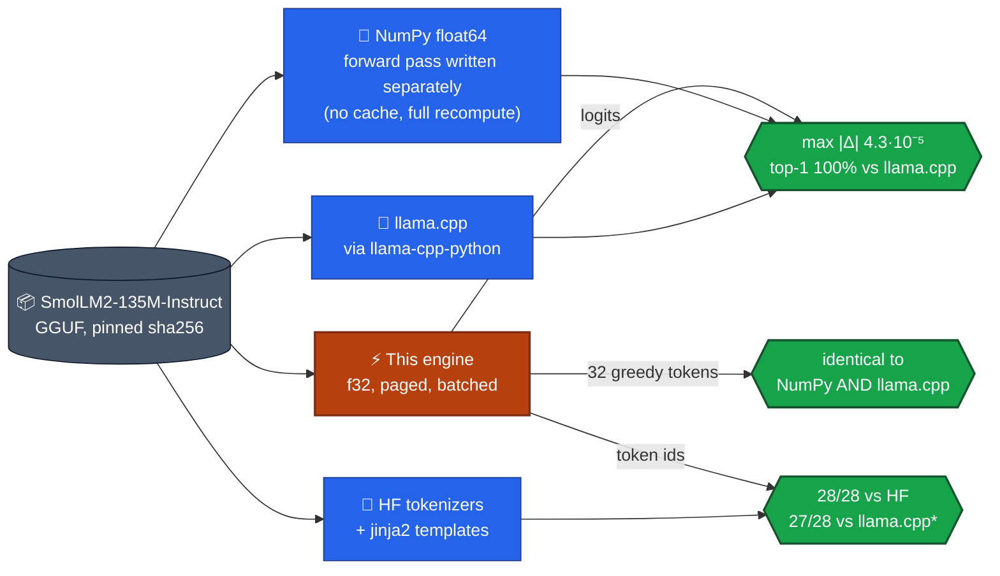

<div align="center">

# ⚡ LLM Inference Engine

### A vLLM-style LLM serving engine written from scratch in Rust: paged KV cache, continuous batching, prefix caching, speculative decoding, and an OpenAI-compatible streaming server, running real pretrained models on CPU

**Runs SmolLM2-135M-Instruct (GGUF) · logits within 4·10⁻⁵ of a float64 reference · greedy output identical to llama.cpp**

<br/>


[**Architecture**](#%EF%B8%8F-architecture) · [**Paged KV**](#-paged-kv-cache--prefix-caching) · [**Batching**](#-continuous-batching) · [**Speculative**](#-speculative-decoding) · [**Validation**](#-validation-against-independent-references) · [**Benchmarks**](#-benchmarks) · [**Quick start**](#-quick-start)

</div>

---

## 📌 TL;DR

The core ideas of production LLM servers like **vLLM** and **TGI**, implemented from first principles and **validated against independent references at every layer**:

| | |
|---|---|
| 🧱 **Paged KV cache** | 16-position blocks, per-sequence block tables, reference counts, LRU eviction |
| 🔗 **Prefix caching** | Blocks keyed by a **chain hash of the whole prefix**: a shared system prompt is computed once |
| 🔁 **Continuous batching** | Decode tokens and **chunked prefill** share each step under a token budget, with **preemption + exact recomputation** when KV runs out |
| 🎯 **Speculative decoding** | A draft model proposes *k* tokens and the target verifies them in **one** pass; output is provably identical to greedy |
| 🧮 **Batch-invariant SIMD kernels** | Every dot product sums in one fixed order (AVX2 *and* portable), so batching, chunking, caching and speculation are **bit-identical** to one-at-a-time decoding |
| 📦 **Model loading** | GGUF v2/v3 (F32 / F16 / BF16 / Q8_0), Llama + Qwen2, GPT-2-style byte-level BPE with special tokens, ChatML templates; per-row **int8** weights |
| 🌐 **Server** | OpenAI-style `/v1/completions` + `/v1/chat/completions`, JSON or **server-sent events**; client disconnect aborts the sequence and frees its blocks |

---

## 🏗️ Architecture



<details>
<summary><b>📦 Module map</b></summary>

<br/>

| Module | Role |
|---|---|
| [`gguf.rs`](src/gguf.rs) | GGUF reader: all metadata types, alignment, bounds checks; dequantises F32/F16/BF16/Q8_0 |
| [`tokenizer.rs`](src/tokenizer.rs) | Byte-level BPE (GGUF vocab + ranked merges, `smollm`/`qwen2` pre-tokenizers, special tokens, ChatML) |
| [`ops.rs`](src/ops.rs) | AVX2/FMA dot products and matmuls (f32 + int8) with a bit-identical portable fallback |
| [`model.rs`](src/model.rs) | Weight loading and the batched forward pass over a flat token list from many sequences |
| [`kv.rs`](src/kv.rs) | Paged KV cache, block pool, refcounts, prefix cache |
| [`engine.rs`](src/engine.rs) | Scheduler: continuous batching, chunked prefill, preemption, streaming text, stop strings |
| [`sampler.rs`](src/sampler.rs) | Greedy, temperature, top-k, top-p, per-request seeded RNG |
| [`spec.rs`](src/spec.rs) | Greedy speculative decoding with a draft model |
| [`server.rs`](src/server.rs) | OpenAI-style HTTP server with SSE |

</details>

---

## 🧱 Paged KV cache & prefix caching



- **Chain hashing:** a block is keyed by *every* token from position 0 to its end, so identical text after a different prefix or at a different position is never wrongly reused. Both cases are tested.
- **Never write a shared block:** the block holding the last prompt token is always recomputed.
- **Freed blocks are poisoned with NaN**, so any stale-cache read corrupts the output and fails a test.
- **Measured:** 6 requests sharing a 384-token prefix → **1,920 of 2,400 prompt tokens served from cache**, and TTFT after the first request dropped **≈25×** (9.0 s → 0.36 s).

---

## 🔁 Continuous batching



On a memory-bound CPU, the win comes from reading each weight row once for the whole batch instead of once per sequence:



<sub>64 requests × 128 greedy tokens. Median TTFT also falls from 6.8 s to 0.7 s, because queued requests start sooner. On SmolLM2-135M, batching 8 sequences gave 3.1× (f32) and 1.9× (int8).</sub>

---

## 🎯 Speculative decoding



| Mode | Tokens/s | Speedup | Draft acceptance | Target passes per token |
|---|:---:|:---:|:---:|:---:|
| Plain greedy | 678 | 1.00× | — | 1.00 |
| **Speculative k = 2** | **784** | **1.16×** | 63% | 0.45 |
| Speculative k = 4 | 714 | 1.05× | 52% | 0.34 |
| Speculative k = 6 | 639 | 0.94× | 44% | 0.29 |

<sub>Honest reading: the target needs fewer than half as many passes per token, but at batch 1 this small model's step cost is dominated by fixed per-pass overhead, so the gain is modest, and larger <i>k</i> loses as acceptance falls.</sub>

---

## 🔬 Validation against independent references



<sub>* The single difference is a string containing bytes 0x01/0x04, which have no token in SmolLM2's vocabulary. The engine maps them to `<unk>` as HF `tokenizers` does, while llama.cpp silently drops them.</sub>

| Check | Result |
|---|---|
| **Logits vs float64 NumPy** (5 prompts, every position) | max abs diff **≤ 4.3·10⁻⁵**, relative **≤ 1.3·10⁻⁶**; llama.cpp is about 1,000× further away (it uses f16 activations), yet agrees on top-1 at every position |
| **Perplexity**, 8,192 tokens of *Alice in Wonderland* | engine **18.8685** · llama.cpp **18.8695** |
| **Greedy generation** | 32 tokens identical across all three implementations; "What is the capital of France?" → *"The capital of France is Paris."* |
| **Tokenizer** (28 texts, 14k tokens: CJK, Devanagari, emoji ZWJ, code, CRLF…) | ids = HF `tokenizers` on 28/28 · chat template = jinja2 |
| **Trained 3M model** | held-out loss equals the JAX trainer to **1.8·10⁻⁸ nats/token** over 59k tokens |

### Testing strategy: execution strategy must not change a single token

Because the kernels are batch-invariant, the tests demand **exact** equality with a one-request, no-cache, whole-prompt reference run, with the cache **poisoned with NaN**:

- full batching · 7-token prefill chunks · 4-token KV blocks · `max_seqs = 2` → **identical**
- forced preemption on a 12-block pool → **identical**, with every block returned
- speculative decoding with three drafts (the target itself, its int8 copy, the 1-layer model) × k ∈ {1, 3, 6} → **identical to greedy**
- the SIMD and portable dot products are bit-identical · the sampler's empirical frequencies match its distribution within 0.005
- GGUF reader: every truncated prefix and every single-byte header corruption is rejected **without a panic**
- server: 4 concurrent requests = offline output; SSE concatenates to the same text; a client disconnect frees its KV blocks (checked via `/metrics`)

**Mutation checks:** an off-by-one in attention, a flipped RoPE sign, a prefix hash that ignores its parent, a prefix match over-counting by one block, a sampler ignoring its seed, and misaligned speculative verification are each caught. One surviving mutant is documented, with the reason it's unreachable.

---

## 📊 Benchmarks

### SmolLM2-135M-Instruct (4 vCPUs, shared machine)

| Weights | Perplexity | Memory | Decode, single stream |
|---|:---:|:---:|:---:|
| F16 → f32 | 18.8685 | 651 MB | ~15–24 tok/s |
| F16 → **engine int8** (`--q8`, per-row) | 18.9171 (+0.26%) | **249 MB** | **~29–45 tok/s** |

<sub>At batch 1 decode is memory-bandwidth-bound (every token reads every weight), so int8 roughly doubles speed on the 135M model. On the 13 MB trained model, whose weights fit in cache, int8 brings no speedup, which is documented. Speed numbers come from a shared, loaded VM and should be treated as rough; accuracy numbers don't depend on load. Full details: <a href="docs/benchmarks.md"><code>benchmarks.md</code></a></sub>

---

## 🚀 Quick start

```sh
cargo build --release
tools/fetch_model.sh smollm2-135m-instruct-f16          # 271 MB, pinned sha256, licence recorded

./target/release/llm chat  --model ~/models/smollm2-135m-instruct-f16.gguf --prompt 'What is the capital of France?'
./target/release/llm serve --model ~/models/smollm2-135m-instruct-f16.gguf --ctx 2048 --listen 127.0.0.1:8080

curl -s  localhost:8080/v1/chat/completions -d '{"messages":[{"role":"user","content":"Name three colours."}],"max_tokens":40}'
curl -sN localhost:8080/v1/completions      -d '{"prompt":"class Stack:\n","max_tokens":32,"stream":true}'
```

<details>
<summary><b>🛠️ More commands</b></summary>

<br/>

```sh
./target/release/llm serve --listen 127.0.0.1:8080 [--q8] [--blocks 2048] [--max-seqs 64]
./target/release/llm generate --prompt 'def fibonacci(n):' --max-tokens 60   # trained model (default)
./target/release/llm ppl   --text FILE [--q8]     # held-out loss
./target/release/llm bench --text FILE            # throughput vs batch size
./target/release/llm spec  --text FILE            # speculative vs greedy

cargo test --release                               # full suite (tiny GGUF fixtures, no download needed)
LLM_GGUF_MODEL=~/models/smollm2-135m-instruct-f16.gguf cargo test --release --test gguf -- --ignored

# retrain the small model (pip install jax)
cd train && python3 build_tokenizer.py 1024 && python3 train.py small 3000 artifacts/small.pkl \
         && python3 export.py artifacts/small.pkl ../models/small.llmw
```

`MODELS_DIR` overrides where `fetch_model.sh` stores models (default `/home/user/models/`).

</details>

---

## ⚠️ Limitations

- **CPU only.** There's no GPU path.
- **Weights are dequantised to f32 at load time.** Q8_0 files aren't kept as int8, so they don't speed anything up; use `--q8` for the engine's own int8.
- **Limited format coverage:** Llama and Qwen2 only, no k-quants, RoPE scaling or partial RoPE. Unsupported files **fail loudly**. Qwen2.5-0.5B is supported by the loader but was only tested on a synthetic tiny Qwen2 file.
- **ChatML templates only.** No tool calls.
- **Benchmarks ran on a shared, loaded VM.** The llama.cpp speed comparison is a lower bound, not a fair best case.

Full list: [`limitations.md`](docs/limitations.md) · Design: [`design.md`](docs/design.md) · Pretrained models: [`pretrained.md`](docs/pretrained.md) · Testing: [`testing.md`](docs/testing.md)

---

## 📁 Repository layout

```text
LLM-INFERENCE-ENGINE/
├── src/          ⚡ gguf · tokenizer · ops (SIMD) · model · kv · engine · sampler · spec · server · bin/llm
├── tests/        ✅ engine (exactness) · gguf (references) · server · tiny GGUF fixtures
├── validate/     🔬 float64 NumPy reference · llama.cpp / HF / jinja2 comparison scripts
├── train/        🧪 JAX training of the 3M-param model + draft model · tokenizer · export
├── models/       📦 small.llmw · draft.llmw (trained here)
├── bench/        📊 run scripts · Alice text · recorded results
├── tools/        ⬇️ fetch_model.sh (pinned sha256)
└── docs/         📖 design · pretrained · testing · benchmarks · limitations
```

---

<div align="center">

**Batch it, cache it, speculate on it, and prove that none of it changes a single token.**

<br/>

Built by **[Siddhant Singh](https://github.com/siddhaantxsingh)** · <sub>MIT License</sub>

</div>
